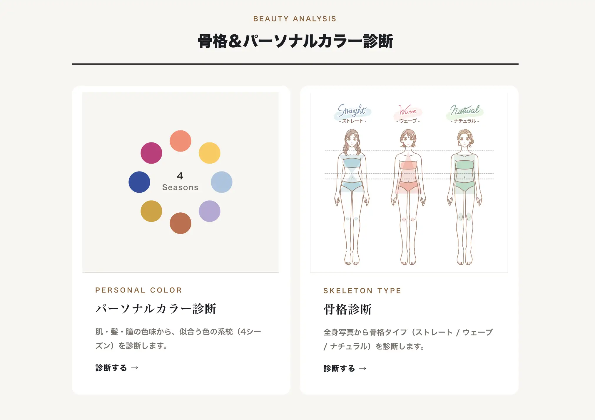

# ①課題名

パーソナルカラー診断（Personal Color Analysis）

## ②課題内容（どんな作品か）

- 顔写真をアップロードすると、AIが肌・髪・瞳の色味を分析し、4シーズン（イエベ春／ブルベ夏／イエベ秋／ブルベ冬）のパーソナルカラーを診断するアプリです。 診断結果として、その人に似合う8色を円環状のカラーパレットで表示し、プロのカウンセリングへの導線（仮）も用意しています。

## ③アプリのデプロイURL

https://personal-color-2026gs.web.app/

## ④アプリのログイン用IDまたはPassword（ある場合）

- ログインなし（写真を選んで診断ボタンを押すだけで利用できます）

## ⑤工夫した点・こだわった点

- 撮影環境の照明による色のズレを補正するため、白い紙を顔の横に持って撮影し、その紙をタップして「本来の白」との差から環境光の色かぶりを打ち消すホワイトバランス補正をブラウザ側（canvas）で実装しました。
- 似合う色は、各シーズン12色の固定パレットをサーバー側で管理し、その中から Claude が8色を選ぶ折衷方式にしました。これにより色そのものはブレず、選び方だけがパーソナライズされます。
- APIキー（Claude）はフロントに出さないよう Firebase Functions のシークレット（Secret Manager）に格納し、サーバー側でのみ使用しています。
- 結果画面は診断結果に応じて画面のアクセント色が変わる仕掛けにしました。似合う色は色相環のように円環で配置し、タップすると色名が表示されます。

## ⑥難しかった点・次回トライしたいこと（又は機能）

- iPhoneの高解像度写真を扱うと、画像の保存時にメモリ不足でブラウザが落ちる問題に苦労しました。読み込んだ時点で長辺1500pxへ縮小し、以降の全処理を縮小画像で行う方式に変えることで解決しました。
- フロント（Hosting）からデプロイ済みの Cloud Functions を呼ぶ際に CORS エラー（preflightのリダイレクト）が発生しました。Firebase Hosting の rewrites を使い、フロントと同じオリジンの `/api/diagnose` から関数を呼ぶ構成にすることで根本的に解決しました。
- パーソナルカラー診断は本来プロが対面で行うもので、写真だけのAI判定には精度の限界があります。「絶対的な断定」ではなく「目安」として位置づけ、確度（confidence）を返す設計にすることで、期待値とのズレを抑えました。

## ⑦フリー項目（感想、シェアしたいこと等なんでも）

「パーソナルカラー＆骨格診断をAIで再現できたら面白いのでは」という思いつきから制作しました。 
環境光の補正やプロの診断ロジックの再現など、"ちゃんと当たる診断"にするための工夫に時間をかけました。診断結果を円環パレットで美しく見せる部分や、そこからカウンセリングへ自然につなげる導線づくりも、サービスとして考える良い経験になりました。
